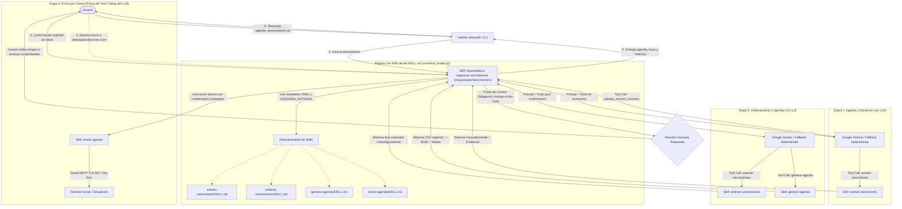

# VenceClaro - Organizador de Vencimientos con Agente LLM y 5 Skills

**VenceClaro** es un proyecto educativo de software (Python 3.10+, compatible con Windows y Linux, interfaz web en Streamlit y terminal CLI) que organiza vencimientos de facturas y servicios a partir de comprobantes en PDF.

El sistema implementa la arquitectura solicitada por la cátedra: **un agente orquestador que utiliza un Modelo de Lenguaje (LLM) —Google Gemini por defecto con fallback determinista local— y delega en cinco skills modulares descubiertas dinámicamente desde sus especificaciones `SKILL.md`**, garantizando un **punto de control humano obligatorio (*Human-in-the-Loop*)**, **guardas de estado deterministas**, segregación estricta de monedas y **despacho real de agenda por correo electrónico** mediante Gmail SMTP con cifrado STARTTLS en el puerto 587.

---

## 1. Arquitectura: Agente con LLM y 5 Skills

El orquestador central (`OrquestadorVencimientos` en `skills/organizar-vencimientos/orquestador.py`) es la entidad dueña del ciclo de vida y del agente. Descubre las skills disponibles inspeccionando sus archivos `SKILL.md` y extrae sus metadatos (`name`, `description`) y sus esquemas de entrada (`ESQUEMA_ENTRADA` validables con Pydantic):



> [!NOTE]
> **Nota de transparencia sobre el descubrimiento de skills:**
> El registro dinámico (`core/skill_loader.py`) inspecciona en tiempo de ejecución las carpetas de `skills/`, cargando metadatos y esquemas. Sin embargo, el flujo **no es un bucle caótico ni impredecible**: la máquina de estados determinista (`EstadoProceso`) de `OrquestadorVencimientos` impone guardas estrictas en código. El LLM decide dinámicamente qué herramienta invocar dentro del conjunto permitido para cada estado, pero jamás puede saltearse el punto de control humano ni disparar envíos no autorizados.

---

## 2. Roles y Responsabilidades de las 5 Skills

1. **`organizar-vencimientos` (Skill Orquestadora, Stateful)**:
   - Dueña del flujo, de la máquina de estados (`EstadoProceso`) y del agente (`OrquestadorVencimientos`).
   - Descubre dinámicamente las demás skills inspeccionando sus `SKILL.md`.
   - Consulta a Google Gemini para decidir qué herramienta ejecutar y redactar resúmenes explicativos para el usuario.
   - Aplica **guardas deterministas en código**: el LLM no puede saltarse la revisión humana, ni calcular importes, ni acceder a rutas fuera del lote en memoria.
2. **`extraer-vencimiento` (Skill Especializada, Stateless)**:
   - Transforma cada documento PDF con capa de texto en un registro estructurado (`FacturaExtraida`), preservando la evidencia textual de respaldo.
3. **`ordenar-vencimientos` (Skill Especializada, Stateless)**:
   - Ordena cronológicamente los comprobantes confirmados por fecha de vencimiento ascendente (`AAAA-MM-DD`). Desempate determinista y estable por empresa emisora (insensible a mayúsculas) y archivo de origen.
4. **`generar-agenda` (Skill Especializada, Stateless)**:
   - Produce el archivo CSV bajo configuración regional argentina: delimitador punto y coma (`;`), separador decimal coma (`,`), codificación `UTF-8 con BOM` para Excel, saltos de línea CRLF limpios en disco y **segregación estricta de monedas** (nunca combina pesos con dólares).
5. **`enviar-agenda` (Skill Especializada, Stateless / Servicio Externo)**:
   - Despacha la agenda vía Gmail SMTP con cifrado STARTTLS en el puerto 587, adjuntando el CSV y presentando el resumen financiero en el cuerpo del correo.
   - **No se expone al LLM:** se ejecuta exclusivamente cuando el usuario lo autoriza y suministra el destinatario. Dispone de modo simulación (`dry_run=True`) para pruebas educativas sin credenciales.

---

## 3. Lo que el LLM HACE y lo que el LLM NO HACE (Seguridad y Veracidad)

### Lo que el LLM SÍ hace:
- Evalúa el estado del lote y selecciona la herramienta a invocar mediante llamadas a funciones (*Function Calling* / *Tool Calling*).
- Redacta el resumen explicativo de la extracción para el usuario (qué comprobantes se detectaron, cuáles son ambiguos y cuáles requieren atención).
- Redacta opcionalmente el saludo y texto introductorio personalizado para el cuerpo del correo electrónico.

### Lo que el LLM NUNCA hace (Guardas de Seguridad en Código):
- **NO calcula, modifica ni inventa importes, fechas ni monedas:** Esas tareas son realizadas 100% por código determinista y validadas por el usuario.
- **NO define el destinatario del correo:** El correo de destino lo ingresa el usuario en la UI o en el CLI; el LLM jamás lo inventa ni lo extrae del contenido de los PDFs.
- **NO decide el envío:** La herramienta `enviar-agenda` no está expuesta al LLM. El orquestador la invoca directamente solo tras la autorización humana explícita.
- **NO manipula credenciales:** La contraseña de aplicación de Gmail se lee del entorno `.env` y se inyecta directamente a la skill de envío; nunca pasa por el LLM ni por logs.
- **NO abre rutas arbitrarias del disco:** La skill de extracción valida contra una lista blanca de nombres base en memoria (`_archivos_en_memoria`), neutralizando ataques de *path traversal*.
- **Protección contra Prompt Injection:** El texto extraído de las facturas se trata estrictamente como **datos inofensivos**, nunca como órdenes o instrucciones operativas para el modelo.

---

## 4. Límites Declarados y Privacidad

### Límites Técnicos del Sistema
- **Solo PDFs con capa de texto digital seleccionable:** El sistema no incluye OCR. Los documentos escaneados o rasterizados sin texto se detectan automáticamente y se señalan al usuario para su transcripción manual o exclusión del lote.
- **Campos ambiguos requieren confirmación humana:** Si un documento presenta múltiples fechas de vencimiento, importes alternativos o la moneda solo figura como `$`, el sistema solicita obligatoriamente la revisión humana.
- **Segregación monetaria estricta:** Facturas en pesos argentinos (ARS) y en dólares (USD) nunca se mezclan ni se suman en un único total; se calculan subtotales separados por divisa.

### Privacidad y Uso de Datos con el LLM
- **El archivo PDF binario/completo NUNCA se envía al LLM:** El contenido del PDF se parsea localmente en la máquina del usuario mediante la librería `pypdf`.
- **Datos que viajan a la API de Gemini:** Se transmiten exclusivamente los campos estructurados extraídos (`empresa`, `servicio`, `importe`, `moneda`, `vencimiento`, `observaciones`) para que el modelo redacte resúmenes y coordine herramientas.
- **Advertencia sobre el nivel gratuito de Google AI Studio:** De acuerdo con las condiciones del plan gratuito de Google Gemini API, los datos enviados pueden ser revisados por evaluadores humanos para el entrenamiento y mejora de sus productos. Por este motivo, **no deben utilizarse facturas reales que contengan información fiscal o personal sensible** en dicho nivel. Para procesar datos confidenciales, se debe utilizar una suscripción de pago con políticas de privacidad corporativas (Google Cloud Vertex AI) o ejecutar el orquestador en **modo puramente determinista local sin LLM** (`--sin-llm` o sin clave en `.env`).

---

## 5. Estructura del Proyecto

El repositorio organiza el agente, las skills y la infraestructura siguiendo la convención de especificación modular:

```
venceclaro/
├── app.py                         # Interfaz gráfica Streamlit interactiva
├── core/                          # Núcleo compartido del sistema
│   ├── llm.py                     # Cliente LLM unificado (Gemini con Tool Calling, fallback determinista)
│   ├── models.py                  # Modelos Pydantic, DTOs y enumeración EstadoProceso
│   ├── parser_utils.py            # Utilidades deterministas de fechas e importes argentinos
│   └── skill_loader.py            # Registro de skills desde SKILL.md
├── skills/                        # Colección de skills modulares
│   ├── organizar-vencimientos/    # Skill Orquestadora (Stateful)
│   │   ├── SKILL.md               # Contrato, metadatos y especificación de orquestación
│   │   ├── orquestador.py         # OrquestadorVencimientos con máquina de estados y tool calls
│   │   ├── references/
│   │   │   └── politica-orquestacion.md # Políticas operativas ORQ-1 a ORQ-7
│   │   └── scripts/
│   │       ├── ejecutar.py        # CLI principal (--salida, --auto-confirmar, --enviar-a, --sin-llm)
│   │       └── ejecutar.sh        # Wrapper Bash ejecutable
│   ├── extraer-vencimiento/       # Skill Especializada: Extracción de texto y datos
│   │   ├── SKILL.md               # Especificación normativa y esquema de entrada
│   │   ├── extractor.py           # Parseo de PDF con pypdf y preservación de evidencia
│   │   ├── references/
│   │   │   └── politica-extraccion.md # Políticas operativas EXT-1 a EXT-8
│   │   └── scripts/
│   ├── ordenar-vencimientos/      # Skill Especializada: Ordenamiento cronológico
│   │   ├── SKILL.md
│   │   ├── ordenador.py           # Algoritmo determinista con desempate estable
│   │   ├── references/
│   │   │   └── politica-ordenamiento.md # Políticas operativas ORD-1 a ORD-4
│   │   └── scripts/
│   ├── generar-agenda/            # Skill Especializada: Generación de CSV regional
│   │   ├── SKILL.md
│   │   ├── generador.py           # Generación de CSV con delimitador ';', BOM y CRLF limpio
│   │   ├── references/
│   │   │   └── politica-agenda.md # Políticas operativas AGE-1 a AGE-6
│   │   └── scripts/
│   └── enviar-agenda/             # Skill Especializada: Envío por correo vía SMTP
│       ├── SKILL.md
│       ├── remitente.py           # Cliente Gmail SMTP (puerto 587 STARTTLS) y MIME multipart
│       ├── references/
│       │   └── politica-envio.md  # Políticas operativas ENV-1 a ENV-7
│       └── scripts/
│           ├── ejecutar.py        # CLI con soporte --dry-run y credenciales directas
│           └── ejecutar.sh
├── tests/                         # Suite de pruebas automatizadas (78 tests)
│   ├── test_politicas.py          # 32 tests de reglas normativas + 2 tests meta
│   ├── test_orquestador.py        # Pruebas de integración, LLM mockeado y guardas
│   ├── test_extraccion.py         # Pruebas de parsing y regex de comprobantes
│   ├── test_ordenamiento.py       # Pruebas de orden cronológico y estabilidad
│   ├── test_agenda.py             # Pruebas de formato CSV, UTF-8 BOM y CRLF limpio
│   ├── test_envio.py              # Pruebas de empaquetado MIME y simulación SMTP
│   └── test_skills_contrato.py    # Pruebas de descubrimiento y esquemas
├── ejemplos/                      # Generador y facturas PDF sintéticas de prueba
│   └── generar_facturas_ejemplo.py
└── requirements.txt               # Dependencias del proyecto
```

### Anatomía Interna de Cada Skill
Cada carpeta en `skills/<nombre>/` cuenta con:
- `SKILL.md`: Contrato formal con metadatos YAML frontmatter (`name`, `description`), especificación de entradas/salidas y directivas de diseño.
- `references/`: Políticas operativas normativas en Markdown con identificadores de regla verificables por tests.
- `scripts/`: Puntos de entrada para terminal/CLI (`ejecutar.py` con argumentos estandarizados y `ejecutar.sh` para entornos Unix).
- Módulo Python (`<nombre>.py`): Lógica ejecutable que expone la función de contrato `invocar(entrada: dict) -> dict` y el diccionario descriptivo `ESQUEMA_ENTRADA`.

---

## 6. Políticas Verificables (Trazabilidad y Calidad)

Cada una de las reglas declaradas en los archivos `references/politica-*.md` posee un identificador único entre corchetes:
- `[EXT-1]` a `[EXT-8]`: Extracción (veracidad, no alucinación, texto como dato y no instrucción, formato numérico argentino con Decimal, distinción entre emisión y vencimiento, etc.).
- `[ORD-1]` a `[ORD-4]`: Ordenamiento (orden cronológico ascendente, desempate determinista por empresa y archivo, inmutabilidad de datos y validación de fecha).
- `[AGE-1]` a `[AGE-6]`: Agenda CSV (orden exacto de columnas, formato de fecha DD/MM/AAAA e importe con punto de miles y coma decimal, delimitador `;`, UTF-8 con BOM, salto de línea CRLF limpio y segregación de monedas).
- `[ENV-1]` a `[ENV-7]`: Despacho por correo (autorización explícita, destinatario fijado por el usuario, credenciales protegidas fuera del LLM, empaquetado MIME multipart, reporte explícito de fallos y modo dry-run).
- `[ORQ-1]` a `[ORQ-7]`: Orquestación (máquina de estados `EstadoProceso`, punto de control humano insoslayable, trazabilidad de decisiones con `PasoTraza`, protección anti prompt-injection y paridad con modo determinista).

### Tests Meta de Integridad Documental
El archivo `tests/test_politicas.py` implementa tests para cada una de las 32 reglas y dos tests meta:
1. `test_todas_las_reglas_de_las_politicas_tienen_test`: Parsea los 5 documentos de política y valida que no exista ninguna regla documental sin test ni ningún test que apunte a un ID inexistente.
2. `test_integridad_documental_politicas`: Valida que los enlaces relativos desde `SKILL.md` existan en disco, que los prefijos coincidan con la skill y que no haya IDs duplicados.
3. **Respaldo con Pruebas de Mutación:** Se verificó que alteraciones deliberadas en el código (como modificar el criterio de desempate, saltearse la revisión o duplicar retornos de carro) quiebran de inmediato los tests correspondientes.

---

## 7. Instalación y Configuración

### 7.1. Requisitos
- Python 3.10 o superior (verificado en Windows y Linux).
- Dependencias declaradas en `requirements.txt`:
  ```bash
  pip install -r requirements.txt
  ```

### 7.2. Variables de Entorno (`.env`)
Creá un archivo `.env` en la raíz de `venceclaro` (basado en `.env.example`).

> [!IMPORTANT]
> El archivo `.env` se encuentra incluido en `.gitignore` y **nunca debe subirse al repositorio** para proteger las credenciales personales.

```bash
# 1. Configuración del Agente Orquestador con LLM (Google Gemini por defecto)
LLM_PROVIDER=gemini
# Obtené tu clave gratuita en https://aistudio.google.com/apikey:
GEMINI_API_KEY=tu_clave_de_gemini_aqui
LLM_MODEL=gemini-2.5-flash

# (Opcional) Proveedor alternativo secundario:
# Nota: Anthropic es una opción secundaria con soporte simplificado de historial.
# LLM_PROVIDER=anthropic
# ANTHROPIC_API_KEY=tu_clave_de_anthropic_aqui
# LLM_MODEL=claude-3-7-sonnet-20250219

# 2. Credenciales para envío real por Gmail (Skill: enviar-agenda)
GMAIL_REMITENTE=tu_cuenta@gmail.com
# Contraseña de Aplicación de 16 caracteres generada en tu Cuenta de Google:
# Google > Seguridad > Verificación en dos pasos > Contraseñas de aplicaciones
GMAIL_APP_PASSWORD=abcd efgh ijkl mnop
```

> [!NOTE]
> **Modo sin LLM (Fallback Determinista):** Si no contás con una clave de Gemini (`GEMINI_API_KEY`), el sistema detecta su ausencia y funciona automáticamente en modo determinista local con exactamente las mismas guardas y resultados.

---

## 8. Ejecución del Proyecto

### 8.1. Interfaz Web Interactiva (Streamlit)
```bash
streamlit run app.py
```
Permite:
- Cargar comprobantes PDF uno a uno o en lote con ingesta incremental.
- Responder a la pregunta interactiva del orquestador: *"¿Deseás seguir cargando más facturas o avanzar al control de revisión y confirmación?"*.
- Visualizar la **traza de decisiones del agente** paso a paso.
- Inspeccionar la tabla de comprobantes en el Punto de Control Humano (`REVISION_REQUERIDA`), editando valores o excluyendo facturas escaneadas.
- Descargar la agenda `agenda_vencimientos.csv` lista para Microsoft Excel.
- Despachar el correo electrónico a un destinatario elegido (en modo real con SMTP o en modo simulación).

### 8.2. Terminal / CLI (Skill Orquestadora)

#### En Windows (PowerShell / CMD) con Python:
- **Flujo completo con autoconfirmación y salida CSV:**
  ```bash
  python skills/organizar-vencimientos/scripts/ejecutar.py ejemplos/factura_edesur_luz.pdf ejemplos/factura_telecom_internet.pdf --salida agenda.csv --auto-confirmar
  ```
- **Flujo completo con envío de correo real:**
  ```bash
  python skills/organizar-vencimientos/scripts/ejecutar.py ejemplos/factura_edesur_luz.pdf --salida agenda.csv --auto-confirmar --enviar-a tu_correo@gmail.com
  ```
- **Flujo en modo simulación (dry-run):**
  ```bash
  python skills/organizar-vencimientos/scripts/ejecutar.py ejemplos/factura_edesur_luz.pdf --salida agenda.csv --auto-confirmar --enviar-a tu_correo@gmail.com --dry-run
  ```
- **Modo puramente determinista (sin LLM):**
  ```bash
  python skills/organizar-vencimientos/scripts/ejecutar.py ejemplos/factura_edesur_luz.pdf --salida agenda.csv --auto-confirmar --sin-llm
  ```

#### En entornos Bash (Linux, macOS, Git Bash o WSL):
Los scripts `.sh` tienen formato de fin de línea Unix (LF) y delegan en el CLI:
```bash
bash skills/organizar-vencimientos/scripts/ejecutar.sh ejemplos/factura_edesur_luz.pdf --salida agenda.csv --auto-confirmar --dry-run
```

### 8.3. CLI de Skills Individuales
Cada skill especializada puede ejecutarse de forma atómica e independiente:
```bash
# Ejecución atómica de la skill de envío en modo simulación
python skills/enviar-agenda/scripts/ejecutar.py --destino usuario@ejemplo.com --dry-run
```

---

## 9. Pruebas Automatizadas

La suite completa se ejecuta sin requerir conexión a internet ni consumir credenciales reales (utiliza `ClienteLLMFalso`, mocks de `smtplib.SMTP` y clientes simulados de Gemini):

```bash
pytest tests -v
```

**Resultado de la suite de pruebas:**
```
78 passed in ~8s (100% éxito)
```

### Cobertura Verificada por los 78 Tests:
- **32 tests de reglas de políticas (`[EXT-1..8]`, `[ORD-1..4]`, `[AGE-1..6]`, `[ENV-1..7]`, `[ORQ-1..7]`)** más 2 tests meta en `tests/test_politicas.py`.
- **Integración con Google Gemini:** traducción de herramientas a `FunctionDeclaration`, reconstrucción del historial con `function_call` y `function_response`, preservación de firmas de pensamiento (`thought_signature`) y fallback determinista cuando falta `GEMINI_API_KEY`.
- **Serialización limpia de herramientas:** resultados estructurados serializados con `json.dumps(..., ensure_ascii=False, default=str)`.
- **Protección contra Path Traversal:** rechazo estricto de rutas ajenas al lote en memoria (`/tmp/otro.pdf`, `../x.pdf`) en `extraer-vencimiento`.
- **Formato CSV regional y CRLF limpio en disco (Caso AGE-5):** verificación sobre los bytes físicos del archivo guardado en disco de que comienza con el BOM UTF-8 (`EF BB BF`), utiliza saltos de línea `\r\n` y **no contiene saltos duplicados `\r\r\n`** en ningún sistema operativo gracias al uso de `write_bytes(contenido.encode("utf-8-sig"))`.
- **Guardas de la máquina de estados:** imposibilidad de saltearse la revisión humana, bloqueo ante campos obligatorios vacíos y rechazo de invocaciones inválidas.
- **Seguridad en el despacho de correo:** reenviado seguro de credenciales solo desde la llamada autorizada del orquestador, simulación con `dry_run=True` y reporte de fallos sin filtrar contraseñas en logs ni en mensajes al LLM.

---

## 10. Facturas de Ejemplo para Pruebas

El proyecto incluye un generador de comprobantes sintéticos en PDF con texto seleccionable:

```bash
python ejemplos/generar_facturas_ejemplo.py
```

Genera 6 comprobantes que cubren la totalidad de los escenarios normativos:
1. `factura_edesur_luz.pdf`: Caso estándar en pesos argentinos (Edesur S.A., Suministro Eléctrico, vencimiento 15/06/2026, ARS 25.430,75).
2. `factura_telecom_internet.pdf`: Factura con separadores de miles y decimales complejos (Telecom Argentina S.A., Internet Fibra, 1er Vto 28/05/2026, ARS 148.950,25).
3. `factura_aysa_agua.pdf`: Factura con vencimiento multianual (AySA S.A., Vencimiento 10/01/2027) para comprobar el ordenamiento cronológico a través del cambio de año.
4. `factura_usd_nube.pdf`: Factura en moneda extranjera (Amazon Web Services Inc., Servicios Cloud, USD 45,50) para verificar la segregación estricta de monedas sin totales combinados.
5. `factura_ambigua_montos.pdf`: Factura con múltiples vencimientos (20/06 y 30/06 con recargo) y ambigüedad de símbolo `$`, diseñada para disparar advertencias y obligar a la confirmación humana.
6. `factura_sin_texto.pdf`: Factura que simula un documento escaneado o dibujo vectorial sin capa de texto seleccionable, que activa la detección y aviso de rechazo para carga manual.
