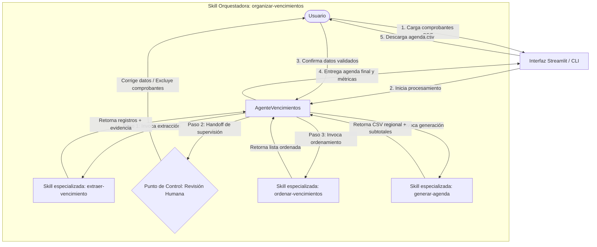

# VenceClaro - Organizador de Vencimientos de Facturas

**VenceClaro** es un proyecto educativo diseñado para demostrar la arquitectura de **un único agente coordinador con cuatro skills (una orquestadora y tres especializadas ejecutadas en secuencia)**, respetando la estructura modular de skills requerida por la cátedra.

---

## 1. Arquitectura: Un Agente y Cuatro Skills

El sistema no fragmenta la lógica en múltiples agentes artificiales ni utiliza modelos de lenguaje ficticios. Implementa una **coordinación determinista, estructurada y transparente** a través de la clase `AgenteVencimientos` y cuatro skills con responsabilidades estrictamente delimitadas:



### Roles y Responsabilidades de las Skills

1. **`organizar-vencimientos` (Skill Orquestadora)**:
   - **Responsabilidad:** Coordinar el flujo completo. Invoca la extracción, gestiona el estado del agente, entrega los registros para revisión humana, reanuda el proceso tras la confirmación, delega el ordenamiento y la generación de la agenda, y consolida el resultado final.
   - **Diferencia clave con las skills especializadas:** No realiza análisis de bajo nivel de archivos PDF, no ordena listas internamente y no formatea líneas CSV. Su valor radica en la gestión de estados, transiciones y políticas de control de calidad.

2. **`extraer-vencimiento` (Skill Especializada)**:
   - **Responsabilidad:** Transformar cada documento PDF con texto seleccionable en un registro estructurado (`FacturaExtraida`), preservando la evidencia textual de respaldo para cada dato (empresa, servicio, importe, moneda, vencimiento).
   - **Regla:** No ordena registros ni genera la agenda.

3. **`ordenar-vencimientos` (Skill Especializada)**:
   - **Responsabilidad:** Ordenar de forma cronológica ascendente los registros confirmados por fecha de vencimiento (`AAAA-MM-DD`).
   - **Criterio de desempate estable:** Ante fechas idénticas, desempata alfabéticamente por empresa emisora y luego por nombre de archivo de origen.
   - **Regla:** No modifica importes, no interpreta documentos ni inventa datos.

4. **`generar-agenda` (Skill Especializada)**:
   - **Responsabilidad:** Producir el archivo CSV final estructurado bajo configuración regional argentina (delimitador punto y coma `;`, separador decimal coma `,` y codificación `UTF-8 con BOM` para Microsoft Excel).
   - **Regla:** Segregación estricta de monedas; nunca suma ni combina monedas dispares en un total acumulado.

5. **`enviar-agenda` (Skill Especializada)**:
   - **Responsabilidad:** Despachar la agenda consolidada por correo electrónico a través de la infraestructura segura de Gmail, adjuntando el archivo CSV y presentando el resumen financiero por moneda en el cuerpo (HTML y texto plano). Cuenta con modo de simulación educativo / sandbox para ejecuciones de prueba o corrección docente sin credenciales cargadas.
   - **Regla:** Protección estricta de credenciales; nunca imprime contraseñas de app en logs.

---

## 2. Implementación Honesta del Agente y Estructura de Skills

Los archivos Markdown (`SKILL.md`) representan especificaciones normativas y operativas; no se ejecutan solos. En **VenceClaro**:
- La clase `AgenteVencimientos` en `core/agent.py` materializa el mecanismo ejecutable que coordina las llamadas en estricto cumplimiento de los procedimientos descritos en cada `SKILL.md`.
- Cada carpeta dentro de `skills/` contiene:
  - `SKILL.md`: Perfil YAML (`name`, `description`) y Procedimiento operativo (objetivo, entradas, pasos, referencias, ejecutable, salida, errores).
  - `references/politica-*.md`: Políticas institucionales de veracidad, ordenamiento, formato y segregación.
  - `scripts/ejecutar.sh`: Punto de entrada Bash ejecutable que recibe argumentos y propaga códigos de salida.
  - `scripts/ejecutar.py`: Punto de entrada Python que reutiliza la lógica central de la skill sin duplicación.

---

## 3. Límites Declarados del MVP

- **Capa de texto requerida:** El MVP está optimizado para comprobantes en PDF con texto digital seleccionable. No incorpora motores pesados de OCR; los comprobantes escaneados o imágenes vacías son detectados y señalados para transcripción manual o exclusión.
- **Sin alucinación ni adivinación:** Si un campo es ambiguo (por ejemplo, coexisten múltiples vencimientos, o la moneda figura únicamente como `$`), el sistema solicita confirmación humana antes de continuar.
- **Protección de datos:** Procesamiento 100% local en memoria durante la sesión. No se persisten facturas en bases de datos externas ni se transmiten datos confidenciales.
- **Separación de monedas:** Las facturas en pesos (ARS) y dólares (USD) conviven en la agenda pero sus totales acumulados se informan estrictamente por separado.

---

## 4. Instalación y Requisitos

- Python 3.10 o superior (verificado con Python 3.13 en Windows).
- Dependencias declaradas en `requirements.txt`:
  - `streamlit`: Interfaz web interactiva.
  - `pypdf`: Extracción pasiva de texto en documentos PDF.
  - `reportlab`: Generación de comprobantes sintéticos de prueba.
  - `pandas`: Visualización tabular en interfaz.
  - `pytest`: Suite de verificación automatizada.

### Instalación de dependencias:
```bash
pip install -r requirements.txt
```

---

## 5. Ejecución del Proyecto

### 5.1. Interfaz Web Interactiva (Recomendada)
Para iniciar la aplicación web en Streamlit:

```bash
streamlit run app.py
```
*Se abrirá automáticamente en su navegador (habitualmente en `http://localhost:8501`).*

---

### 5.2. Ejecución mediante Scripts de Skills

#### En entornos Windows (PowerShell / Símbolo del sistema):
Dado que PowerShell y `cmd.exe` no interpretan scripts de shell Bash (`.sh`) de manera nativa sin un emulador configurado, se ejecutan directamente mediante Python:

1. **Extraer datos de un comprobante:**
   ```bash
   python skills/extraer-vencimiento/scripts/ejecutar.py ejemplos/factura_edesur_luz.pdf
   ```
2. **Ordenar registros (JSON a lista ordenada):**
   ```bash
   python skills/ordenar-vencimientos/scripts/ejecutar.py ruta_a_registros.json
   ```
3. **Generar agenda CSV:**
   ```bash
   python skills/generar-agenda/scripts/ejecutar.py ruta_a_ordenados.json --salida agenda.csv
   ```
4. **Orquestador completo (modo batch con autoconfirmación):**
   ```bash
   python skills/organizar-vencimientos/scripts/ejecutar.py ejemplos/factura_edesur_luz.pdf ejemplos/factura_telecom_internet.pdf --salida agenda_final.csv --auto-confirmar
   ```

#### En entornos Linux, macOS o Windows con Git Bash / WSL:
Los archivos `.sh` cuentan con permisos y formato de fin de línea Unix (LF) listos para ejecutarse:

```bash
bash skills/organizar-vencimientos/scripts/ejecutar.sh ejemplos/factura_edesur_luz.pdf ejemplos/factura_telecom_internet.pdf --salida agenda.csv --auto-confirmar
```

---

## 6. Generación de Ejemplos Sintéticos y Pruebas

El proyecto incluye un generador de facturas sintéticas educativas (sin datos reales):

```bash
python ejemplos/generar_facturas_ejemplo.py
```

### Ejecución de Pruebas Automatizadas:
```bash
pytest tests -v
```

Casos cubiertos en la suite:
- Extracción de facturas compatibles y extracción de evidencia textual.
- Interpretación de importes argentinos con miles (`.`) y coma decimal (`,`).
- Detección de comprobantes sin capa de texto y aviso explícito.
- Tratamiento de ambigüedades en montos, fechas y monedas.
- Ordenamiento cronológico entre meses y cambios de año calendario.
- Desempate estable por empresa emisora y archivo.
- Generación de CSV con delimitador `;`, codificación UTF-8 con BOM y tildes.
- Segregación estricta de monedas sin sumas mezcladas.
- Flujo completo de orquestación con rechazo por campos obligatorios faltantes, exclusión manual y reanudación.
